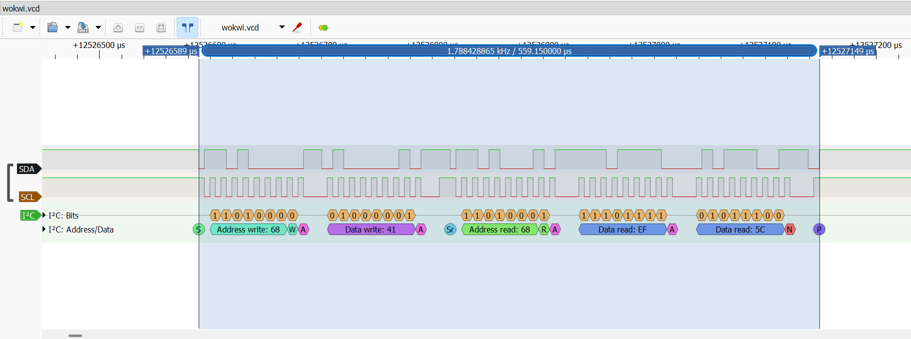
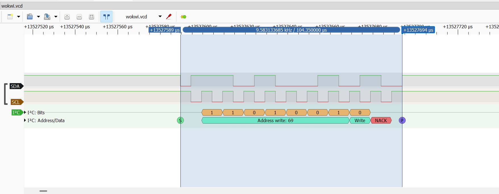

# Lab 4 — I2C Fault Injection

PulseView screenshots comparing the last successful communication identified in the lab with communication after a simulated peripheral failure.

- [Full test report and UART evidence](https://docs.google.com/document/d/1mMwtw9YUV-qiAuHMGlWaU8QaRK1wLnRnp5C-2thL3_s/edit?usp=sharing)
- [Bug report — system freezes after I2C peripheral connection loss](../bug-reports/lab-04-i2c.md)

## Setup

ESP32 and MPU6050 in Wokwi. Expected device address: **0x68** (7-bit). Logic-analyzer mapping: **D0 = SDA, D1 = SCL**. Captures are decoded using PulseView's I2C decoder.

## 1. Last successful communication

The decoded sequence shows START → **0x68 + Write → ACK** → data write **0x41 → ACK** → repeated START → **0x68 + Read → ACK** → data **0xEF → ACK** → data **0x5C → NACK** → STOP.

The final NACK is sent by the master to end the read; it is a normal part of this successful transaction, not the peripheral-failure NACK shown below.

The selected transaction spans approximately **12.526589–12.527149 s** in capture time (displayed selection duration: **559.15 µs**). These cursor positions mark the transaction selection, not the exact time of the last ACK.

## 2. Communication after simulated failure

The decoded sequence shows START → **0x69 + Write → NACK** → STOP. The addressed device does not acknowledge the request. 0x69 differs from the expected 0x68.

The selected transaction spans approximately **13.527589–13.527694 s** in capture time (displayed selection duration: **104.35 µs**). These are selection boundaries, not an exact NACK timestamp or a measurement of the recovery interval.

The full test report records that temperature and main-loop heartbeat output stop after the fault and that switching FAULT OFF does not restore operation. The screenshots document the protocol transactions; longer-term silence and recovery observations are described in the linked report.

## Original capture

The original capture, **`wokwi.vcd`**, will be added to this folder separately. Once uploaded, open it in PulseView, assign SDA and SCL to the I2C decoder, and navigate to the time ranges above. No capture file is included in this commit.
